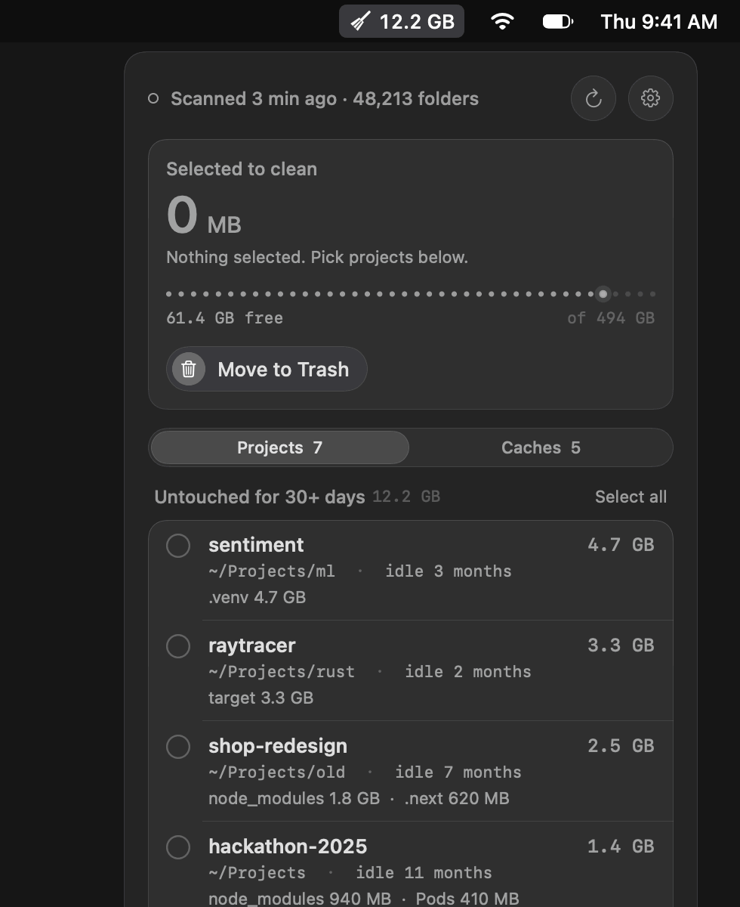
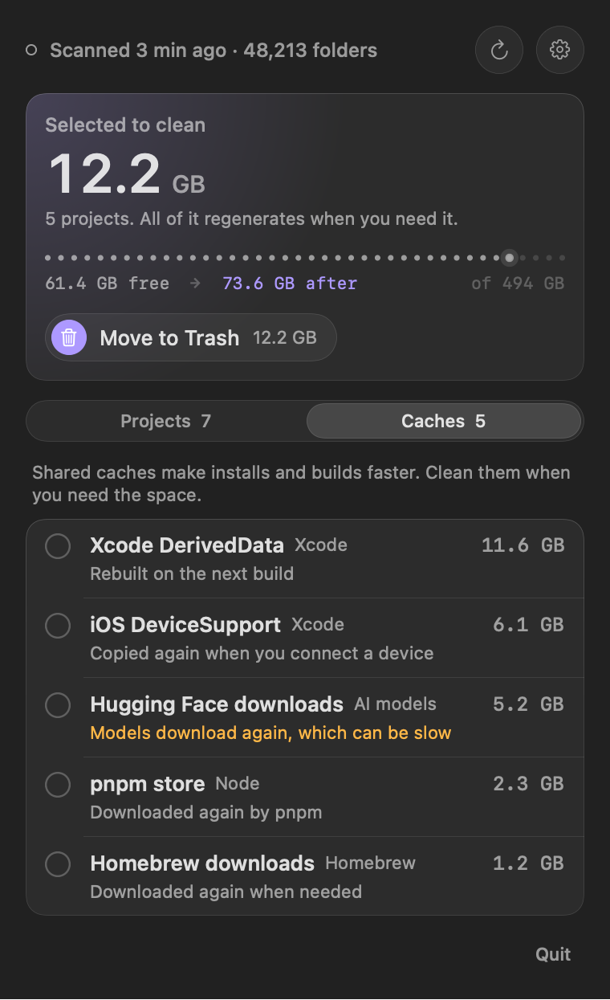
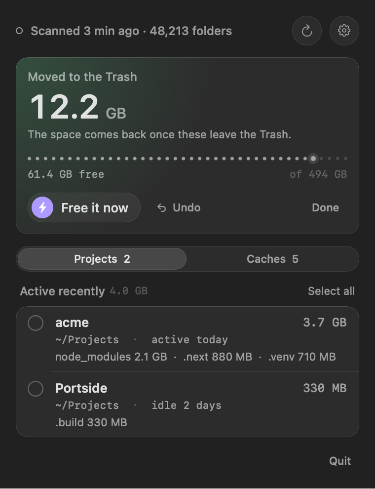

# Sweepside

[](https://github.com/springmusk026/Sweepside/actions/workflows/build.yml)
[](LICENSE)

**Find the gigabytes your old projects are sitting on, and get them back in one click.**

Every project you've ever cloned keeps its `node_modules`, `.venv`, `target/` or `Pods` long after you stop
working on it. Sweepside lives in your menu bar, finds those folders across all your projects, and suggests
the ones you haven't touched in a month. Everything it cleans regenerates with `npm install`, `cargo build`
or the next Xcode build.

<p align="center">
  
</p>

## Features

- **Every ecosystem at once**: `node_modules`, `.next`, `.nuxt`, `.svelte-kit`, `.turbo`, `.venv`, `.tox`, `target` (Rust, Maven), `build` and `.gradle`, `.build` (Swift), `DerivedData`, `Pods`, `.dart_tool`, `vendor` (PHP), `_build`/`deps` (Elixir), `.zig-cache`, `.stack-work`, `obj`/`bin` (.NET), `.terraform` and more.
- **Safe by design**: each folder is checked against its project file, so `target` only counts next to a `Cargo.toml` or `pom.xml`, and `.venv` only with a `pyvenv.cfg` inside. A folder called `node_modules` holding your notes is left alone. Sweepside never follows links and never looks inside Library, Pictures, Music or Movies.
- **Suggests idle projects**: groups folders by project (the git repository) and preselects those you haven't touched in 30 days, which you can change.
- **Honest sizes**: pnpm and uv hard-link packages from a shared store, so deleting a project's copy frees almost nothing. Sweepside counts only space you'll actually get back, and shows the shared part separately.
- **Shared caches too**: Xcode DerivedData and iOS DeviceSupport, Homebrew, npm, pnpm, Yarn, Bun, pip, uv, Poetry, Cargo, Go, Gradle, Maven, CocoaPods, Playwright, Hugging Face and more. Caches are never preselected, because they make builds faster.
- **Trash first, with Undo**: cleaning moves folders to the Trash. **Undo** puts them back. **Free it now** deletes just those folders from the Trash, not the rest of it.
- **Command line**: `sweepside`, `sweepside --caches`, `sweepside clean`, `sweepside --json`.
- **Native and offline**: SwiftUI with no dependencies and no network access. A scan of a typical home folder takes a few seconds.

<p align="center">
  
  
</p>

## Install

Requires macOS 14 Sonoma or later, on Apple silicon or Intel.

### Download

Get `Sweepside.zip` from the [latest release](https://github.com/springmusk026/Sweepside/releases/latest),
unzip it and move `Sweepside.app` to Applications.

Sweepside isn't notarized by Apple (it's a free side project), so macOS blocks the first launch. To allow it,
open **System Settings › Privacy & Security** and click **Open Anyway** next to the Sweepside message, or run:

```sh
xattr -dr com.apple.quarantine /Applications/Sweepside.app
```

### Build from source

With the Xcode command line tools (`xcode-select --install`):

```sh
git clone https://github.com/springmusk026/Sweepside.git
cd Sweepside
./build.sh        # builds, installs to ~/Applications and launches
```

### Command line

Link the app's binary into your PATH (Settings shows the exact command, with a Copy button):

```sh
ln -sf /Applications/Sweepside.app/Contents/MacOS/Sweepside /opt/homebrew/bin/sweepside
```

```console
$ sweepside
  SIZE  IDLE       PROJECT        FOLDERS              WHERE
4.7 GB  3 months   sentiment      .venv                ~/Projects/ml/sentiment
3.3 GB  2 months   raytracer      target               ~/Projects/rust/raytracer
2.5 GB  7 months   shop-redesign  node_modules, .next  ~/Projects/old/shop-redesign

10.5 GB in 3 projects untouched for 30+ days. Run sweepside clean to move it to the Trash.

$ sweepside --caches                 # Xcode, Homebrew, npm, pip, Cargo… too
$ sweepside clean                    # asks first; --yes to skip, --permanent to delete
$ sweepside clean --stale 90         # only projects idle for 90+ days
$ sweepside --in ~/work --json       # scan one folder, as JSON
```

## Also from me

- [Portside](https://github.com/springmusk026/Portside): see every dev server running on your Mac, which project it belongs to, and stop it in one click.

## Contributing

Is a build folder from your toolchain missing? Adding it is usually a one-line rule. See [CONTRIBUTING.md](CONTRIBUTING.md).

## License

[MIT](LICENSE)
